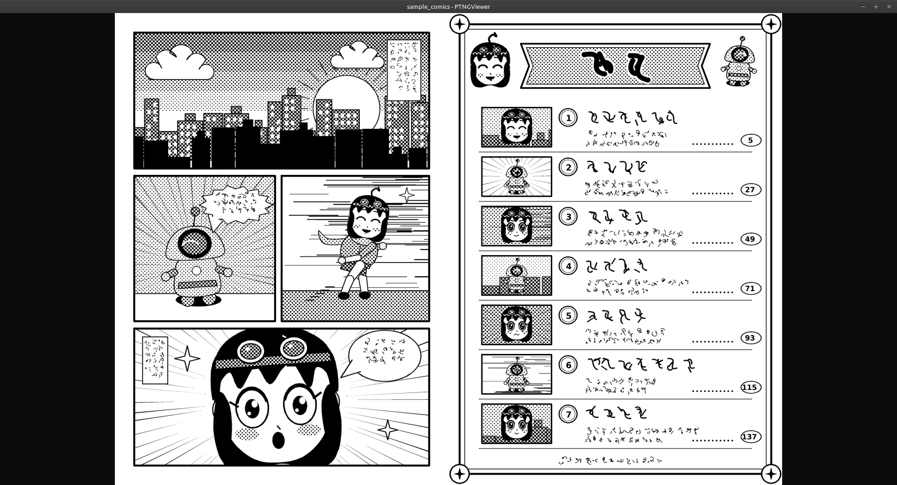
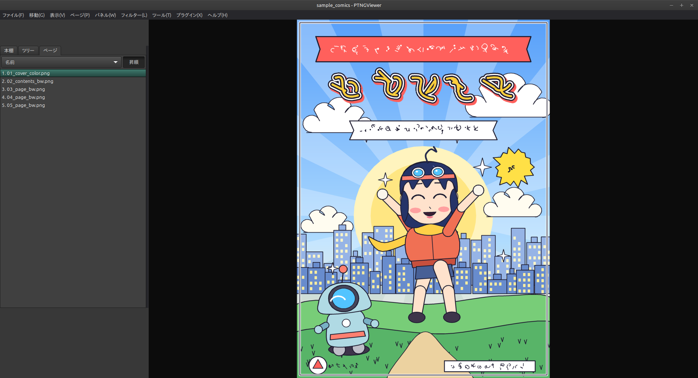

<h1 align="center">PTNGViewer</h1>

<p align="center">
  <b>Linux 向けの画像・コミックビューワー</b><br>
  <b>An image &amp; comic viewer for Linux</b>
</p>

<p align="center">
  
  
  
  <a href="https://ko-fi.com/rurihari"></a>
</p>

<p align="center">
  <a href="#ja"><b>🇯🇵 日本語</b></a> &nbsp;|&nbsp; <a href="#en"><b>🇬🇧 English</b></a>
</p>

<p align="center">
  
</p>

---

<a id="ja"></a>

# 🇯🇵 日本語

**PTNGViewer** は、Linux 向けの画像・コミックビューワーです。
フォルダや書庫（ZIP・RAR・7-Zip など）の画像を、見開きや単ページで、快適に読めます。

> [!TIP]
> 画面の「左右のパネル」は、タブを好きな位置に並べ替えられます。使いやすい配置に作り替えてください。

## ✨ 主な機能

| | 機能 | 説明 |
|---|---|---|
| 📖 | **見開き / 単ページ表示** | 読むものに合わせて切り替えられます |
| ⌨️ | **自由度の高いキー設定** | キーやマウスの操作に、好きな機能を割り当てられます |
| 🎞️ | **スライドショー** | 画像を自動で順に表示します |
| 🗂️ | **本棚** | お気に入りのフォルダを保存して、すぐに開けます |
| 🔖 | **しおり** | 読みかけの場所を保存できます |
| 🧭 | **前回の続きから再開** | 前に読んでいたページから始められます |
| 🪟 | **パネルのタブを自由に配置** | 左右のパネルのタブを入れ替えて、自分の使いやすい形にできます |
| 🎨 | **フィルター** | 色調補正などの画像フィルターを、重ねて掛けられます |
| 🔌 | **プラグイン** | 機能を追加して拡張できます |
| 🌏 | **22 言語の表示** | 画面の言語を切り替えられます |

## 🖼️ スクリーンショット

<p align="center">
  <br>
  <sub>単ページ表示と、左のパネル（ページ一覧）</sub>
</p>

<p align="center">
  <br>
  <sub>見開き表示</sub>
</p>

## 📦 対応している形式

> [!NOTE]
> 対応する形式は、お使いの環境のライブラリのバージョンなどによって、増えたり減ったりします。

### 🖼️ 画像

| 種類 | 形式 |
|---|---|
| **そのまま使える** | JPEG、PNG、GIF、BMP、TIFF、ICO / CUR、ANI、PNM（PBM / PGM / PPM）、TGA、XPM、XBM、QTIF |
| **追加の部品が必要** | WebP（`webp-pixbuf-loader`）<br>AVIF / HEIF / HEIC（`libheif` の gdk-pixbuf 部品）<br>JPEG XL（`libjxl` の gdk-pixbuf 部品）<br>SVG（`librsvg`） |

### 🗜️ 書庫（アーカイブ）

| 形式 | 補足 |
|---|---|
| **ZIP / CBZ / EPUB** | |
| **RAR / CBR** | RAR5 を含む |
| **7-Zip / CB7** | |
| **TAR / CBT** | tgz・tbz2・txz・tar.zst など（gz・bz2・xz・zst・lz4 の圧縮つき） |
| **LZH / LHA** | |
| **CAB** | |
| **ISO** | |
| **CPIO** | |

## 📥 入手と使いかた

> [!IMPORTANT]
> ※本アプリはクローズドソース（非公開）です。Release 欄に自動表示されている `Source code` リンクには、README 等のドキュメント類のみが含まれています。

[**Releases ページ**](https://github.com/rurihari/PTNGViewer/releases) から、お使いの形式のファイルを入手してください。

```bash
# Flatpak (.flatpak ファイル)
flatpak install --user PTNGViewer-<バージョン>.flatpak
flatpak run io.github.rurihari.PTNGViewer

# AppImage
chmod +x PTNGViewer-<バージョン>-x86_64.AppImage
./PTNGViewer-<バージョン>-x86_64.AppImage
```

アプリの中の **ヘルプ → マニュアル** に、使いかたとプラグインの作りかたがあります。

## 💬 開発を応援する・連絡先

PTNGViewer は無料で使えます。気に入ったら、開発を応援していただけるとうれしいです。

[](https://ko-fi.com/rurihari)
&nbsp;
[](https://x.com/rurihari_crafts)

作者: **rurihari**

<p align="right"><a href="#en">🇬🇧 English ↓</a> &nbsp;|&nbsp; <a href="#">↑ ページの先頭へ</a></p>

---

<a id="en"></a>

# 🇬🇧 English

**PTNGViewer** is an image and comic viewer for Linux.
Read images from folders and archives (ZIP, RAR, 7-Zip and more) comfortably, as two-page spreads or single pages.

> [!TIP]
> The tabs in the left and right panels can be rearranged freely, so you can build the layout that suits you.

## ✨ Features

| | Feature | Description |
|---|---|---|
| 📖 | **Two-page spread / single page** | Switch the view to suit what you are reading |
| ⌨️ | **Highly customizable key bindings** | Assign any action to keys and mouse operations |
| 🎞️ | **Slideshow** | Show images automatically, one after another |
| 🗂️ | **Bookshelf** | Save your favorite folders and open them quickly |
| 🔖 | **Bookmarks** | Save the place where you stopped reading |
| 🧭 | **Resume where you left off** | Start again from the page you were reading |
| 🪟 | **Freely arranged panel tabs** | Rearrange the tabs of the left and right panels |
| 🎨 | **Filters** | Stack image filters such as color correction |
| 🔌 | **Plugins** | Extend the app with plugins |
| 🌏 | **22 UI languages** | Switch the display language |

## 🖼️ Screenshots

<p align="center">
  <br>
  <sub>Single page view with the left panel (page list)</sub>
</p>

<p align="center">
  <br>
  <sub>Two-page spread</sub>
</p>

## 📦 Supported formats

> [!NOTE]
> The supported formats may vary depending on the versions of the libraries on your system.

### 🖼️ Images

| Type | Formats |
|---|---|
| **Works out of the box** | JPEG, PNG, GIF, BMP, TIFF, ICO / CUR, ANI, PNM (PBM / PGM / PPM), TGA, XPM, XBM, QTIF |
| **Needs an extra component** | WebP (`webp-pixbuf-loader`)<br>AVIF / HEIF / HEIC (gdk-pixbuf loader of `libheif`)<br>JPEG XL (gdk-pixbuf loader of `libjxl`)<br>SVG (`librsvg`) |

### 🗜️ Archives

| Format | Notes |
|---|---|
| **ZIP / CBZ / EPUB** | |
| **RAR / CBR** | Including RAR5 |
| **7-Zip / CB7** | |
| **TAR / CBT** | tgz, tbz2, txz, tar.zst, etc. (compressed with gz, bz2, xz, zst or lz4) |
| **LZH / LHA** | |
| **CAB** | |
| **ISO** | |
| **CPIO** | |

## 📥 Download and usage

> [!IMPORTANT]
> Note: This app is closed source (not publicly available). The `Source code` links shown automatically in the Releases section contain only documentation such as the README.

Get the file in the format you prefer from the [**Releases page**](https://github.com/rurihari/PTNGViewer/releases).

```bash
# Flatpak (.flatpak file)
flatpak install --user PTNGViewer-<version>.flatpak
flatpak run io.github.rurihari.PTNGViewer

# AppImage
chmod +x PTNGViewer-<version>-x86_64.AppImage
./PTNGViewer-<version>-x86_64.AppImage
```

Inside the app, **Help → Manual** explains how to use it and how to write plugins.

## 💬 Support and contact

PTNGViewer is free to use. If you like it, your support for its development would be greatly appreciated.

[](https://ko-fi.com/rurihari)
&nbsp;
[](https://x.com/rurihari_crafts)

Author: **rurihari**

<p align="right"><a href="#ja">🇯🇵 日本語 ↑</a> &nbsp;|&nbsp; <a href="#">↑ Back to top</a></p>
